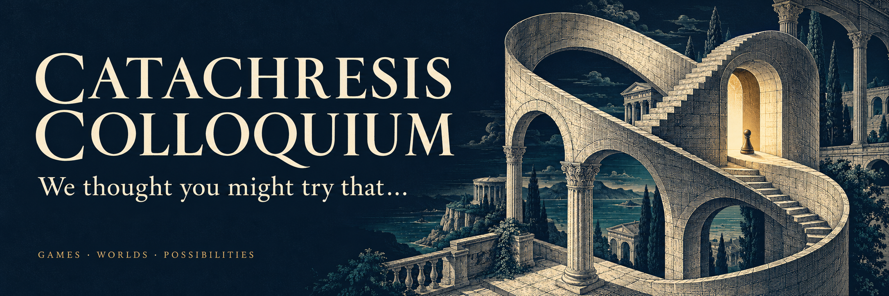

<!-- SPDX-License-Identifier: CC-BY-SA-4.0 -->

<picture>
  <source media="(prefers-reduced-motion: reduce)" srcset="">
  
</picture>

An independent studio making computer games, tabletop games, roleplaying experiences and simulations.

We bring unlikely ideas into playable company, then invite you to see what happens. We like worlds that answer back, characters who become familiar, and discoveries that make you reconsider everything you thought you could do. Above all, we make games we want to play—and leave room for you to get ideas of your own.

Curiosity is welcome at the Colloquium. You may find it reciprocated.

[Explore our repositories](https://github.com/orgs/catachresis-colloquium/repositories) · [Contribute](https://github.com/catachresis-colloquium/.github/blob/main/CONTRIBUTING.md)

[View the still banner](https://raw.githubusercontent.com/catachresis-colloquium/.github/main/profile/assets/hero.png)
